# OpenStack private cloud with Kolla-Ansible

This is a lab I did during my Master's at ESGI Paris (Systems, Networks & Cloud Computing), together with a classmate. The goal was to deploy a multi-node OpenStack cloud ourselves with Kolla-Ansible, then actually use it: create projects and users, build networks, launch instances, attach volumes and play with availability zones and host aggregates.

Everything in this repo is what we really ran. The screenshots are from our own deployment. Passwords are not in the repo: Kolla generates them, and the lab scripts read them from environment variables.

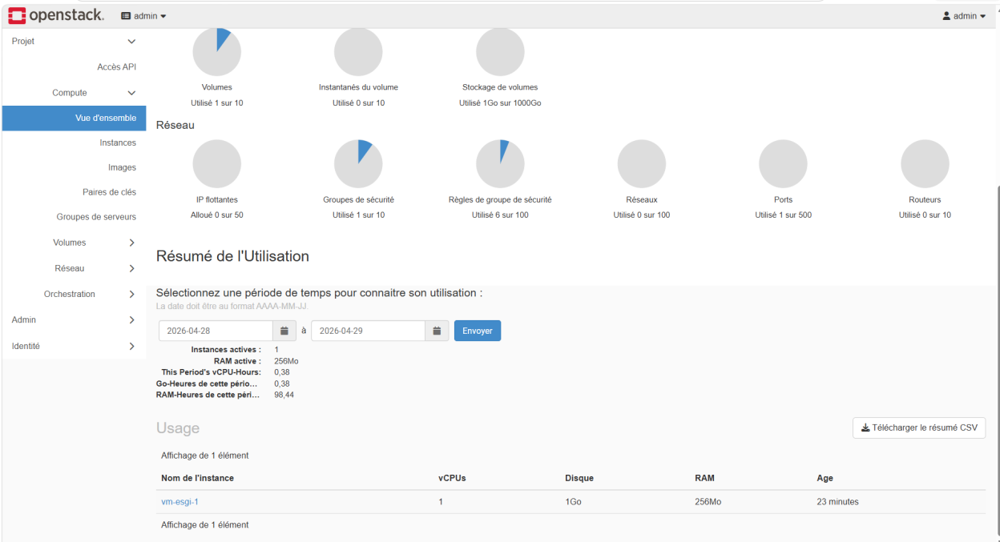

## What this does

OpenStack is basically your own AWS, running on your own servers. Instead of renting VMs, networks and disks from a cloud provider, you install the software that provides them, and then users can create those resources themselves from a web dashboard or an API, just like on a public cloud.

OpenStack is made of separate services that each do one job:

| Service | What it does | AWS equivalent |
|---|---|---|
| Keystone | users, projects, logins and tokens | IAM |
| Nova (+ Placement) | creates the VMs and picks which server runs them | EC2 |
| Glance | stores the OS images the VMs boot from | AMIs |
| Neutron | private networks, routers, IPs, security groups | VPC |
| Cinder | disks you can attach to VMs | EBS |
| Heat | infrastructure from templates | CloudFormation |
| Horizon | the web dashboard | the AWS console |

Installing all of that by hand is long and painful. **Kolla-Ansible** does it for you: every service runs in its own Docker container, and Ansible deploys and configures those containers on each server based on an inventory (which server does what) and one config file (`globals.yml`).

So the flow of this project is:

```
  3 Ubuntu servers (controller, compute, storage)
            │
            ▼
  scripts/ ── prepare the nodes, install Kolla-Ansible, deploy
            │
            ▼
  a working private cloud: API + Horizon dashboard
            │
            ▼
  lab/ ── use it like a cloud: projects, users, networks, VMs, volumes, scheduling
```

1. The **controller** runs the "brain" of the cloud: the APIs, the database, the scheduler, the network services and the dashboard.
2. The **compute** node is where the virtual machines actually run.
3. The **storage** node provides the disks (Cinder volumes) that get attached to those VMs.
4. Once it's deployed, the `lab/` scripts use the cloud the way a team would: create a project and users, build networks, launch VMs, attach volumes and control where VMs get placed.

The details of each step are below.

## Repository layout

```
inventory/multinode      the groups we set in the Kolla inventory
config/globals.yml       our Kolla configuration
scripts/                 deployment, in the order we ran it
  01-prepare-node.sh       every node: dependencies, kolla user, sudo
  02-storage-lvm.sh        storage node: LVM volume group for Cinder
  03-install-kolla.sh      controller: kolla-ansible, config, generated passwords
  04-deploy.sh             controller: bootstrap, prechecks, pull, deploy
  05-post-deploy.sh        controller: CLI, admin credentials, health checks
lab/                     what we did with the cloud once it was up
  10-projects-users.sh     projects, users, groups, roles
  20-networks.sh           two VXLAN networks and a router
  30-instances-volumes.sh  image, flavor, keypair, instance, volume
  40-az-aggregates.sh      availability zones and host aggregates
docs/screenshots/        screenshots from the deployment
```

## The setup

The nodes were Ubuntu VMs on a 192.168.200.0/24 management network:

| Node | IP | Role |
|---|---|---|
| controller01 | 192.168.200.100 | control plane, networking, monitoring, Horizon |
| compute01 | 192.168.200.120 | hypervisor |
| stockage01 | 192.168.200.200 | block storage (Cinder on LVM) |

We planned a second compute node (compute02), but in the end we ran with one. You can see it in the hypervisor list below. Since the nodes were themselves VMs, Nova runs the instances with QEMU rather than KVM.

Each node had three network interfaces:

- `eth0` for management and the OpenStack APIs
- `eth1` for the VXLAN tunnels between nodes
- `eth2` as the external network for Neutron

With a single controller there is nothing to load-balance, so HAProxy is turned off and the "VIP" is just the controller's IP.

What ended up running, straight from the service catalog: Keystone, Glance, Nova with Placement, Neutron, Cinder and Heat, plus Horizon as the dashboard. Swift was enabled in `globals.yml` too, but it needs its rings prepared before deploying and it never made it into the catalog, so we ran without object storage.

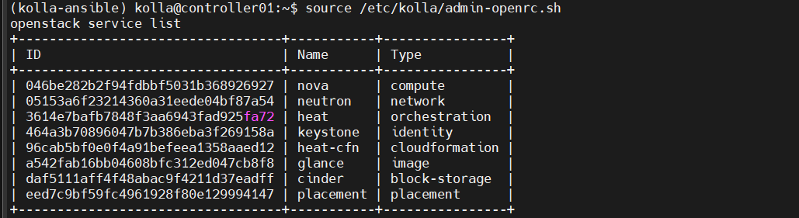

## Deploying it

The scripts follow the exact order we used.

**1. On every node:** dependencies, a `kolla` user with passwordless sudo, and the controller's SSH key so Ansible can reach it.

```bash
./scripts/01-prepare-node.sh
# then, from the controller:
ssh-copy-id kolla@<node_ip>
```

**2. On the storage node:** the `cinder-volumes` volume group on the second disk.

```bash
./scripts/02-storage-lvm.sh /dev/sdb
```

**3. On the controller:** install Kolla-Ansible in a virtualenv, copy `globals.yml`, set up the inventory and generate all service passwords with `kolla-genpwd`.

```bash
./scripts/03-install-kolla.sh
```

The inventory needs one manual step: Kolla's `multinode` example has a lot of service groups, and we only changed the top ones (`[control]`, `[network]`, `[compute]`, `[monitoring]`, `[storage]`). Those are in `inventory/multinode`.

**4. Deploy.** This is mostly waiting while Kolla pulls and starts the containers.

```bash
./scripts/04-deploy.sh
```

**5. Post-deploy:** install the OpenStack CLI, generate `admin-openrc.sh` and check that the services are up.

```bash
./scripts/05-post-deploy.sh
source /etc/kolla/admin-openrc.sh
```

Horizon is then on `http://192.168.200.100`, user `admin`, with the password from `keystone_admin_password` in `/etc/kolla/passwords.yml`.

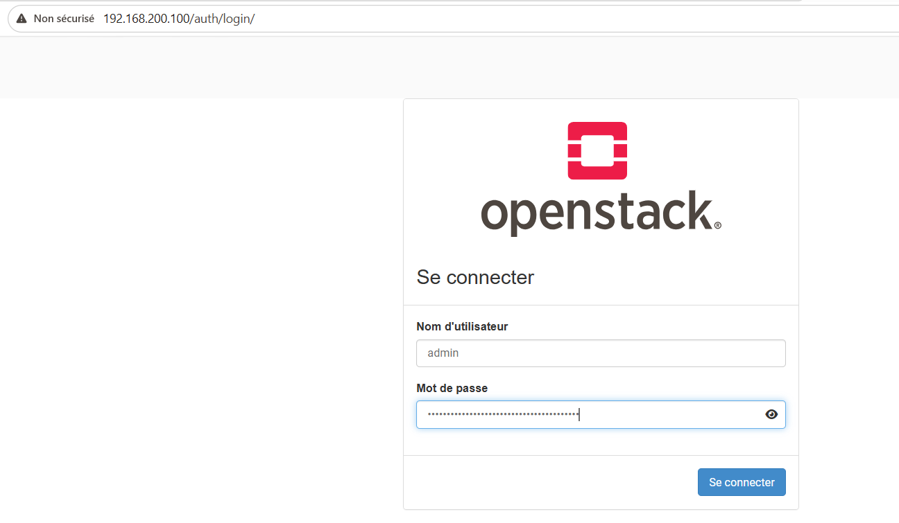

## Using the cloud

All the scripts in `lab/` expect the admin credentials to be loaded (`source /etc/kolla/admin-openrc.sh`).

### Projects, users and groups

An `esgi` project with its own admin, and two regular users who get the `member` role through a group instead of one by one.

```bash
USER_PASSWORD='choose-one' ./lab/10-projects-users.sh
```

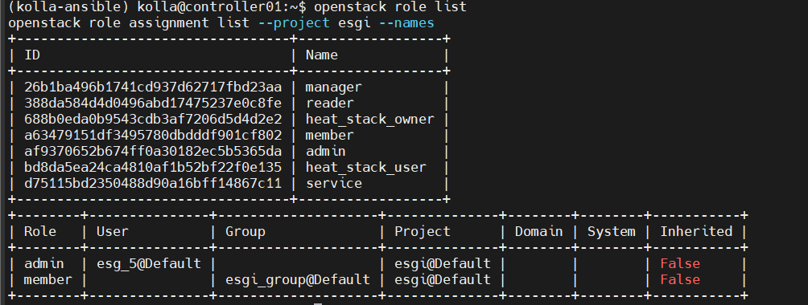

### Networks

Two private VXLAN networks, `10.10.1.0/24` and `10.10.2.0/24`, connected by a router so instances on both can talk to each other.

```bash
./lab/20-networks.sh
```

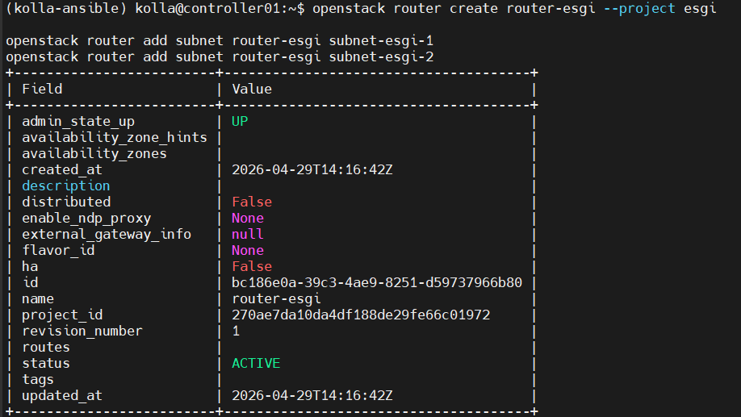

### Instances and volumes

A CirrOS image, a small `m1.tiny` flavor, a keypair, ICMP and SSH allowed in the default security group, one instance, and a 1 GB Cinder volume attached to it (it shows up as `/dev/vdb` inside the VM).

```bash
./lab/30-instances-volumes.sh
```

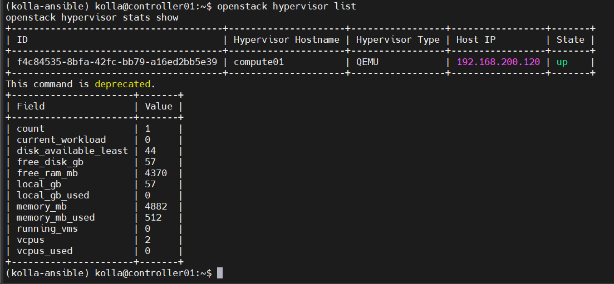
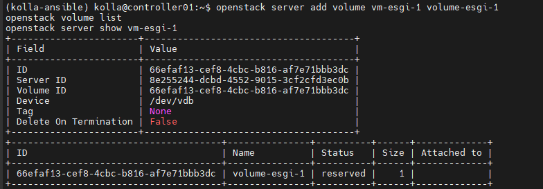
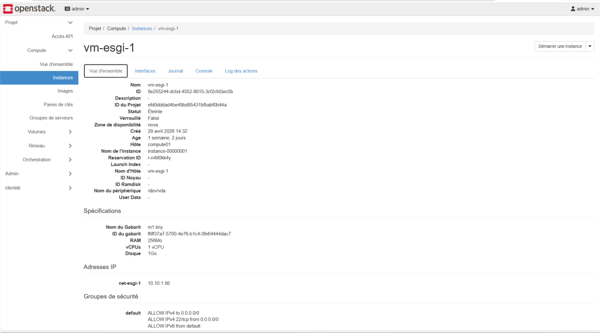

### Availability zones and host aggregates

Launching an instance in a zone and forcing it onto a specific host with `nova:compute01`, then grouping hosts in an aggregate with a `disk=ssd` property the scheduler can match against. We also looked at the scheduler config inside the `nova_scheduler` container to see which filters were active.

```bash
./lab/40-az-aggregates.sh
```

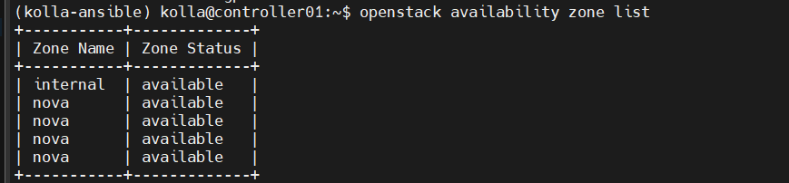
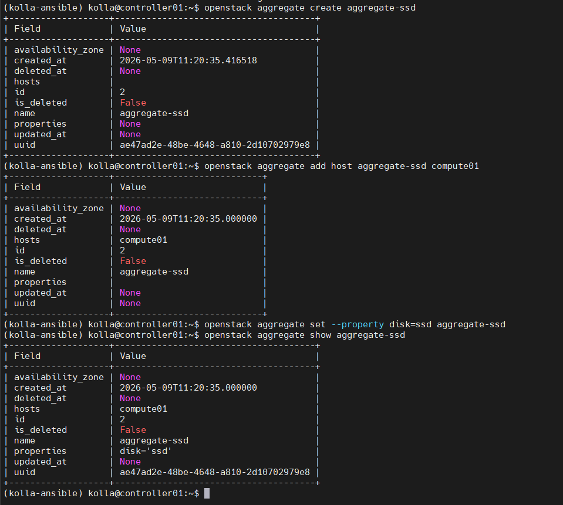

## Troubleshooting

The most useful thing I learned here was how to debug Neutron from the controller. Each router and each DHCP server lives in its own Linux network namespace, so you can run commands from "inside" the virtual network:

```bash
sudo ip netns
sudo ip netns exec qrouter-<router-id> ping 10.10.1.56
sudo ip netns exec qdhcp-<network-id> ping 10.10.1.56
```

In our case the instance was running and had its IP, but the pings from the router and DHCP namespaces didn't get through. That narrows it down to the path between the controller and the compute node (the VXLAN tunnel on `eth1`, security group rules applied on the compute side, or the instance itself still booting) rather than the router config. It's the kind of check you can't do on a public cloud, and it made Neutron a lot less of a black box.

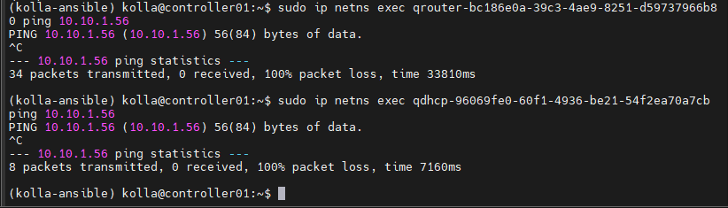

## What I took away from it

The hard part of deploying OpenStack isn't the deployment itself, it's getting the networking right before you start. Almost every problem we hit came back to interfaces, IPs or the external network.

It also made the cloud a lot less magic for me. When you create a VM in AWS or GCP you just click a button. Here you see every step: Keystone checks the token, the Nova scheduler picks a hypervisor through Placement, Glance hands over the image, Neutron sets up the ports and security groups, Cinder attaches the volume, and nova-compute finally starts the VM. Once you've debugged that chain yourself, public clouds make a lot more sense.

Besides the hands-on part, the lab covered how OpenStack is built: the main services and their endpoints, ML2/OVS vs ML2/OVN for Neutron, storage options for Nova, and how scheduling filters work with availability zones and aggregates.
